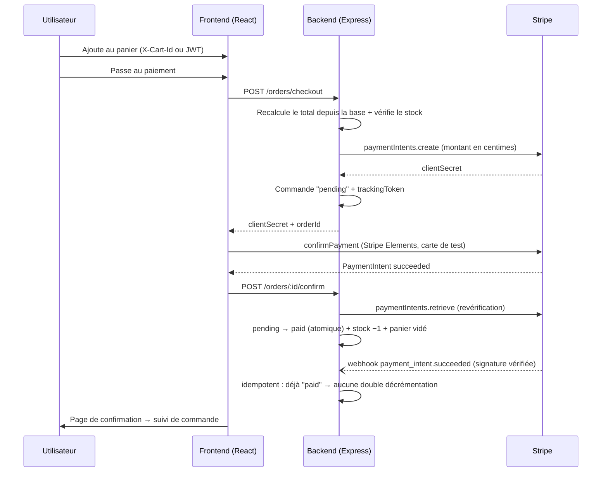

# NovaTech — Plateforme E-commerce Fullstack

> **Projet d'examen** — Workshop : développement d'une plateforme e-commerce fullstack dédiée aux **produits informatiques**, avec **React + TypeScript**, **Node.js + Express**, **MongoDB (Mongoose)** et **Stripe** (mode test), tests automatisés, conteneurisation Docker et pipeline CI/CD.


Une boutique complète : catalogue filtrable, panier invité **ou** connecté (JWT), tunnel de paiement **Stripe Elements**, confirmation et **suivi de commande**, avec décrémentation du stock après paiement et pipeline de qualité (Jest, Supertest, React Testing Library, ESLint, GitHub Actions).

---

## 🎯 Objectifs pédagogiques couverts

| Module du workshop | Livrable | Où ? |
|---|---|---|
| 1. Initialisation & environnement | Monorepo, scripts npm, Git | `package.json`, scripts `install-all` / `dev` |
| 2. Modélisation des données | Produits, paniers (expiration TTL), commandes, utilisateurs | `backend/src/models/` |
| 3. API produits & panier | Liste, filtres, ajout, consultation, modification, suppression | `backend/src/controllers/` |
| 4. Intégration Stripe | PaymentIntents, commandes *pending*, webhook signé | `backend/src/services/stripe.service.js` |
| 5. Tests backend | Jest + Supertest, Stripe moqué, MongoDB en mémoire | `backend/tests/` |
| 6. Init frontend React | React + TypeScript + Vite + Axios + routage | `frontend/src/` |
| 7. Composants principaux | Catalogue, panier, paiement Stripe Elements, confirmation | `frontend/src/pages/` |
| 8. Tests frontend | Jest + React Testing Library | `frontend/src/__tests__/` |
| 9. Automatisation & CI/CD | Dockerfiles, docker-compose, GitHub Actions | `Dockerfile.*`, `.github/workflows/` |
| 10. Déploiement effectif | Render (API) + Vercel (web) + Atlas | `render.yaml`, `frontend/vercel.json` |
| 11. Bonus | ✅ Décrémentation du stock · ✅ Suivi de commande · ✅ Authentification JWT | `backend/src/services/order.service.js`, `frontend/src/pages/OrderDetailPage.tsx`, `backend/src/middleware/auth.js` |

---

## 🧱 Stack technique

| Couche | Technologie |
|---|---|
| Frontend | React 19, TypeScript (strict), Vite, React Router 7, Axios, Stripe Elements (`@stripe/react-stripe-js`) |
| Backend | Node.js 22, Express 5, Mongoose 8, Stripe SDK, JWT (jsonwebtoken), bcryptjs, Helmet, express-rate-limit |
| Base de données | MongoDB Atlas (production) / MongoDB (Docker) / MongoDB en mémoire (tests) |
| Tests | Jest 30, Supertest, React Testing Library, jest-dom, mongodb-memory-server |
| Qualité | ESLint 10 (flat config), TypeScript `--noEmit`, GitHub Actions |
| Conteneurisation | Docker multi-stage (API + web/nginx), docker-compose (mongo + api + web) |
| Déploiement | Render (backend), Vercel (frontend), GitHub Actions (CI/CD) |

---

## 🗂️ Architecture du monorepo

```
novatech-ecommerce/
├── backend/                    # API REST (Express + Mongoose + Stripe)
│   ├── src/
│   │   ├── config/             # env.js (config centralisée), db.js (connexion)
│   │   ├── models/             # Product, Cart, Order, User (Mongoose)
│   │   ├── controllers/        # product, cart, order, auth
│   │   ├── routes/             # product, cart, order, auth
│   │   ├── middleware/         # auth (JWT), cart (X-Cart-Id), errors, rate limits
│   │   ├── services/           # stripe.service, order.service (idempotence)
│   │   ├── utils/              # asyncHandler
│   │   ├── app.js              # assemblage Express (CORS, helmet, routes)
│   │   ├── server.js           # démarrage + arrêt propre
│   │   └── seed.js             # catalogue de démonstration + compte démo
│   ├── tests/                  # 5 suites Jest/Supertest (base en mémoire)
│   └── scripts/smoke.mjs       # smoke test de bout en bout (paiement réel test)
├── frontend/                   # SPA React + TypeScript
│   ├── src/
│   │   ├── api/                # client Axios central (+ produits, panier, commandes, auth)
│   │   ├── components/         # Navbar, ProductCard, CheckoutForm, ProtectedRoute…
│   │   ├── context/            # AuthContext (JWT), CartContext, ToastContext
│   │   ├── pages/              # Home, Cart, Checkout, Confirmation, Orders, Login…
│   │   ├── types/              # types partagés
│   │   └── __tests__/          # 6 suites Jest/RTL
│   └── public/images/products/ # 12 illustrations SVG du catalogue
├── .github/workflows/          # ci.yml (tests) + deploy.yml (CD)
├── Dockerfile.backend / Dockerfile.frontend / nginx.conf
├── docker-compose.yml          # mongo + api + web
├── render.yaml                 # blueprint du service backend
└── docs/                       # checklist des exigences + scénario de soutenance
```

**Séparation des responsabilités** : routes → contrôleurs → services → modèles. Le frontend ne parle jamais directement à MongoDB ni à Stripe avec la clé secrète : tout transite par l'API.

---

## 🗄️ Modèle de données (Mongoose)

### Product
`name` · `description` · `price` (euros, converti en centimes pour Stripe) · `category` (enum de 6 catégories) · `stock` (entier ≥ 0) · `imageUrl` · `timestamps`

### Cart — panier invité **ou** utilisateur
`user` (réf. User, unique sparse) **ou** `sessionId` (en-tête `X-Cart-Id`, unique sparse) · `items[]` (réf. Product + quantité 1–99) · `expiresAt` (**index TTL : expiration automatique après 7 jours d'inactivité**)

### Order — instantané figé au moment de l'achat
`user?` · `sessionId?` · `items[]` (name, imageUrl, priceAtPurchase, quantity) · `totalAmount` · `currency` · `stripePaymentIntentId` · `trackingToken` (suivi invité) · `status` (`pending → paid → shipped → delivered`, + `failed`) · `paidAt` · `timestamps`

### User (bonus JWT)
`name` · `email` (unique, minuscule) · `password` (**bcrypt, jamais renvoyé** — `select: false`)

---

## 🔌 API REST

Base : `http://localhost:5000/api`

| Méthode | Route | Auth | Description | Codes |
|---|---|---|---|---|
| GET | `/health` | — | Sonde de santé (Render/Docker) | 200 / 503 |
| GET | `/products` | — | Catalogue paginé : `?category=`, `?search=`, `?sort=recent\|price-asc\|price-desc`, `?page=`, `?limit=` | 200 |
| GET | `/products/categories` | — | Catégories distinctes | 200 |
| GET | `/products/:id` | — | Détail produit | 200 / 400 / 404 |
| POST | `/auth/register` | X-Cart-Id (optionnel) | Inscription + fusion du panier invité | 201 / 400 / 409 |
| POST | `/auth/login` | X-Cart-Id (optionnel) | Connexion + fusion du panier invité | 200 / 400 / 401 |
| GET | `/auth/me` | JWT | Profil courant | 200 / 401 |
| GET | `/cart` | JWT **ou** X-Cart-Id | Panier courant | 200 |
| POST | `/cart` | JWT **ou** X-Cart-Id | Ajouter un article (vérifie le stock) | 200 / 400 / 404 / 409 |
| PUT | `/cart/items/:productId` | JWT **ou** X-Cart-Id | Modifier la quantité (1–99) | 200 / 400 / 404 / 409 |
| DELETE | `/cart/items/:productId` | JWT **ou** X-Cart-Id | Retirer un article | 200 / 400 / 404 |
| DELETE | `/cart` | JWT **ou** X-Cart-Id | Vider le panier | 200 |
| POST | `/orders/checkout` | JWT **ou** X-Cart-Id | Créer PaymentIntent + commande *pending* (**montant recalculé serveur**) | 201 / 400 / 409 |
| POST | `/orders/:id/confirm` | JWT **ou** X-Order-Token | Confirmer après paiement (état revérifié chez Stripe) | 200 / 400 / 404 |
| GET | `/orders/mine` | JWT | Historique de l'utilisateur | 200 / 401 |
| GET | `/orders/:id` | JWT **ou** X-Order-Token | Suivi de commande | 200 / 400 / 404 |
| POST | `/orders/webhook` | signature Stripe | Webhook (corps brut) : paiement réussi/échoué | 200 / 400 |

---

## 💳 Flux de paiement Stripe



**Deux mécanismes complémentaires** garantissent la cohérence :
1. **Webhook signé** (`STRIPE_WEBHOOK_SECRET`, corps brut + HMAC SHA-256) : source de vérité en production.
2. **Endpoint `/confirm`** appelé par le frontend : indispensable en local (avant configuration du webhook) et revérifié auprès de Stripe.

L'un comme l'autre passent par `markOrderPaid()` : un `findOneAndUpdate` **atomique** sur `{ status: "pending" }` — un webhook rejoué ou une double confirmation ne peuvent ni décrémenter le stock deux fois, ni vider le panier deux fois.

---

## 🔐 Sécurité

- **Prix et montants jamais lus depuis le client** : `totalAmount` est recalculé serveur à partir des prix en base.
- **Stock** : validé à l'ajout au panier **et** revalidé au checkout ; décrémentation avec garde `stock >= quantité` (jamais négatif, même en concurrence).
- **Webhook** : vérification cryptographique de la signature Stripe (corps brut obligatoire).
- **JWT** : signés côté serveur (`JWT_SECRET`), expiration 7 jours, mots de passe bcrypt (10 tours), jamais renvoyés par l'API.
- **Helmet** (en-têtes HTTP), **CORS restreint** à `FRONTEND_URL`, **rate limiting** sur `/auth` et `/checkout`.
- **Idempotence** des confirmations de paiement (atomique MongoDB).
- **Secrets** : `.env` gitignoré, exemples fournis (`.env.example`), aucune clé dans le code ou le CI.
- **Suivi invité** : jeton de suivi aléatoire (`trackingToken`), réponses 404 génériques (pas de fuite d'existence de commandes d'autrui).

---

## 🚀 Installation locale

### Prérequis
- Node.js ≥ 20 (développé et testé avec Node 22) et npm
- Un compte MongoDB Atlas (ou MongoDB local/Docker)
- Un compte Stripe en **mode test**

### Étapes

```bash
# 1. Dépendances (backend + frontend + racine)
npm run install-all
npm install

# 2. Variables d'environnement
cp backend/.env.example backend/.env    # puis renseignez-le (voir tableau)
cp frontend/.env.example frontend/.env

# 3. Données de démonstration (12 produits + compte démo)
npm run seed

# 4. Lancer backend (5000) + frontend (5173) simultanément
npm run dev
```

Application : **http://localhost:5173** — API : **http://localhost:5000/api/health**

### `backend/.env`

| Variable | Description | Exemple |
|---|---|---|
| `NODE_ENV` | development / production | `development` |
| `PORT` | Port de l'API | `5000` |
| `MONGODB_URI` | URI MongoDB (Atlas) | `mongodb+srv://…` |
| `STRIPE_SECRET_KEY` | Clé secrète Stripe **mode test** | `sk_test_…` |
| `STRIPE_WEBHOOK_SECRET` | Secret du webhook (`whsec_…`) | voir §Déploiement |
| `JWT_SECRET` | Longue chaîne aléatoire | `openssl rand -hex 32` |
| `FRONTEND_URL` | Origines CORS autorisées | `http://localhost:5173` |

### `frontend/.env`

| Variable | Description | Exemple |
|---|---|---|
| `VITE_API_URL` | URL de l'API | `http://localhost:5000/api` |
| `VITE_STRIPE_PUBLIC_KEY` | Clé **publique** Stripe (test) | `pk_test_…` |

> **Compte de démonstration** (créé par le seed) : `demo@novatech.fr` / `Demo1234!`

---

## ✅ Tests

```bash
npm test                 # backend puis frontend
# ou séparément :
npm test --prefix backend
npm test --prefix frontend
```

| Suite | Contenu |
|---|---|
| `backend/tests/products.test.js` | Catalogue : pagination, filtres, tri, 400/404, sonde de santé |
| `backend/tests/auth.test.js` | Inscription, connexion, JWT, doublons, **fusion du panier invité** |
| `backend/tests/cart.test.js` | CRUD complet invité + connecté, validation des quantités, stock 409, isolation entre utilisateurs |
| `backend/tests/checkout.test.js` | Montant **recalculé serveur** (falsification ignorée), stock insuffisant 409, confirmation idempotente, autorisations |
| `backend/tests/webhook.test.js` | Signature invalide 400, `paid` + décrémentation + panier vidé, **rejeu idempotent**, paiement échoué |
| `frontend/src/__tests__/*.tsx` | Catalogue, panier, formulaire Stripe (succès/refus), authentification, routage, 404 |

Le backend est testé avec **MongoDB en mémoire** (`mongodb-memory-server`) et le service Stripe **moqué** : aucun appel réseau, aucune base réelle. Le frontend est testé en jsdom avec React Testing Library.

### Smoke test de bout en bout (paiement réel, mode test)

Avec l'API démarrée et le seed appliqué :

```bash
cd backend
npm run smoke
```

Le script déroule **le parcours complet** attendu à la soutenance : santé → catalogue → auth → CRUD panier → checkout → **paiement réel avec `pm_card_visa`** → confirmation → stock décrémenté → panier vidé → **webhook avec signature HMAC réelle** → idempotence → suivi de commande, et affiche un tableau de vérifications (28 contrôles).

---

## 🐳 Docker

```bash
# Stack complète : MongoDB + API + Frontend (nginx)
STRIPE_SECRET_KEY=sk_test_... \
VITE_STRIPE_PUBLIC_KEY=pk_test_... \
docker compose up --build

# Résultat : web http://localhost:8080 · api http://localhost:5000
```

- `Dockerfile.backend` : image Node 22 alpine, `npm ci --omit=dev`, utilisateur non-root, healthcheck.
- `Dockerfile.frontend` : build multi-stage (Vite → nginx) avec routing SPA et cache des assets.
- `docker-compose.yml` : mongo (volume + healthcheck), api (dépend du healthcheck), web.

---

## 🔄 CI/CD (GitHub Actions)

| Workflow | Déclencheur | Étapes |
|---|---|---|
| `ci.yml` | chaque push / PR | lint backend → tests backend (Jest) → lint frontend → build (typecheck TS) → tests frontend |
| `deploy.yml` | push sur `main` | mêmes vérifications, puis Deploy Hook Render + déploiement Vercel |

Le déploiement ne s'active que si les secrets correspondants sont configurés (`Settings → Secrets and variables → Actions`) :
`RENDER_BACKEND_HOOK`, `VERCEL_TOKEN`, `VERCEL_ORG_ID`, `VERCEL_PROJECT_ID`, et les variables `DEPLOY_RENDER` / `DEPLOY_VERCEL` à `true`. **Aucun secret n'apparaît dans le YAML.**

En l'état, Render et Vercel redéploient déjà automatiquement via leur intégration Git ; `deploy.yml` permet de rendre ce déclenchement explicite et de bloquer un déploiement si les tests échouent.

---

## ☁️ Déploiement (Render + Vercel + Atlas + Stripe)

### Déploiement en production (actuel)

| Composant | URL |
|---|---|
| Frontend (Vercel) | https://novatech-ecommerce.vercel.app |
| API (Render) | https://novatech-api-7qa9.onrender.com |
| Sonde de santé | https://novatech-api-7qa9.onrender.com/api/health |
| Webhook Stripe | https://novatech-api-7qa9.onrender.com/api/orders/webhook |

Render et Vercel sont reliés au dépôt GitHub : chaque push sur `main` redéploie automatiquement les deux services.

### Procédure reproductible (nouveau compte)

1. **MongoDB Atlas** — créez un cluster gratuit (M0), un utilisateur et récupérez l'URI (`mongodb+srv://…`), autorisez l'IP `0.0.0.0/0` pour Render.
2. **Backend sur Render** — nouveau Web Service → connectez le repo → *Root directory* `backend` → build `npm ci --omit=dev` → start `npm start` (ou importez le blueprint `render.yaml`). Variables : `NODE_ENV=production`, `MONGODB_URI`, `STRIPE_SECRET_KEY`, `JWT_SECRET`, `STRIPE_WEBHOOK_SECRET`, `FRONTEND_URL=https://votre-app.vercel.app`. Health check : `/api/health`.
3. **Webhook Stripe** — Dashboard → Developers → Webhooks → *Add endpoint* : `https://votre-api.onrender.com/api/orders/webhook`, événements `payment_intent.succeeded`, `payment_intent.payment_failed`, `payment_intent.canceled` → copiez le `whsec_…` dans Render.
4. **Frontend sur Vercel** — import du repo → *Root directory* `frontend` (framework détecté : Vite) → variables `VITE_API_URL=https://votre-api.onrender.com/api` et `VITE_STRIPE_PUBLIC_KEY=pk_test_…`.
5. **Vérification de bout en bout** : commandez avec la carte `4242 4242 4242 4242` → confirmation → le statut passe à *Payée* et le stock baisse.

> 💡 En local, le webhook peut être simulé sans le dashboard : `stripe listen --forward-to localhost:5000/api/orders/webhook` (Stripe CLI), puis `stripe trigger payment_intent.succeeded`. L'endpoint `/confirm` couvre déjà le cas où le webhook n'est pas configuré.

---

## 🧪 Cartes de test Stripe (mode test)

| Scénario | Numéro | Résultat |
|---|---|---|
| Paiement réussi | `4242 4242 4242 4242` | Commande *payée*, stock décrémenté |
| Paiement refusé | `4000 0000 0000 0002` | Commande *failed*, stock inchangé |
| Authentification 3D Secure | `4000 0025 0000 3155` | Vérification puis succès |

Date future quelconque, CVC 3 chiffres, code postal quelconque.

---

## 🎬 Scénario de démonstration (soutenance)

1. **Catalogue** : filtres par catégorie, recherche « nova », tri par prix.
2. **Panier invité** : ajouter 2 produits → badge navbar → modifier quantité → supprimer un article.
3. **Création de compte** : le panier invité est **automatiquement rattaché** au compte.
4. **Paiement** : checkout → carte `4242…` → page de confirmation avec statut *Payée*.
5. **Bonus** : « Mes commandes » → suivi avec chronologie (commandée → payée) → retour catalogue : **le stock a diminué**.
6. **Résilience** : payer avec `4000…0002` → commande marquée *échouée*, stock intact.

Détails complets : [`docs/DEMO-SOUTENANCE.md`](docs/DEMO-SOUTENANCE.md)

---

## 📚 Livrables académiques

- [`RAPPORT-EXPERIENCE.md`](RAPPORT-EXPERIENCE.md) — court rapport de retour d'expérience.
- [`docs/CHECKLIST-EXIGENCES.md`](docs/CHECKLIST-EXIGENCES.md) — traçabilité module par module (exigence → fichiers → tests).
- [`docs/DEMO-SOUTENANCE.md`](docs/DEMO-SOUTENANCE.md) — script de démonstration chronométré.

---

## 🛠️ Scripts racine

| Commande | Rôle |
|---|---|
| `npm run install-all` | Installe backend + frontend |
| `npm run dev` | Backend + frontend en parallèle |
| `npm run seed` | Catalogue de démonstration + compte démo |
| `npm test` | Tous les tests (backend + frontend) |
| `npm run lint` | ESLint backend + frontend |
| `npm run build` | Build production du frontend (typecheck inclus) |
| `npm run smoke` | Smoke test de bout en bout (backend démarré requis) |

---

*Projet académique — aucune vente réelle, Stripe en mode test uniquement.*
